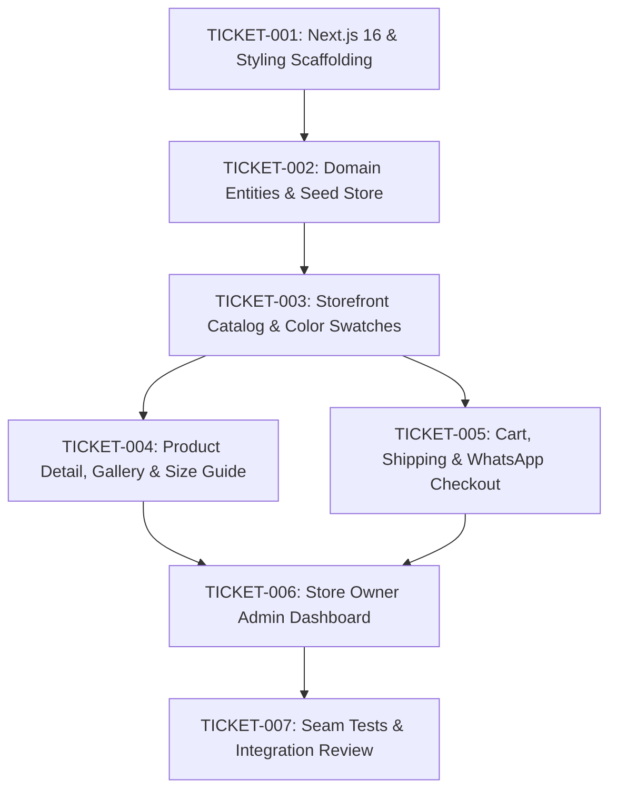

# Implementation Task Graph (Tickets)

## Ticket Definitions

### TICKET-001: Next.js 16 & Styling Scaffolding
- **Status**: Ready
- **Blocks**: TICKET-002
- **Description**: Scaffold Next.js 16 App Router with TypeScript, Tailwind CSS, Arabic Cairo/Tajawal font styling, RTL direction support, and Lucide React icons.

### TICKET-002: Domain Entities & Seed Store
- **Status**: Blocked by TICKET-001
- **Blocks**: TICKET-003
- **Description**: Define TypeScript interfaces for Product, ColorVariant, SizeOption, Category, Order, and ShippingZone. Implement unified data repository with Supabase and localStorage/seed fallback.

### TICKET-003: Storefront Catalog & Interactive Color Swatches
- **Status**: Blocked by TICKET-002
- **Blocks**: TICKET-004, TICKET-005
- **Description**: Build responsive modern luxury storefront homepage and catalog with category filtering, search, sorting, and product cards with interactive color swatches that immediately swap card photos on hover/click.

### TICKET-004: Product Detail, Color-Linked Gallery & Size Guide
- **Status**: Blocked by TICKET-003
- **Blocks**: TICKET-006
- **Description**: Build `/product/[slug]` with dynamic photo gallery syncing to chosen color, disabled/faded styling for inactive colors and sold-out sizes, interactive Size Guide modal, and Add-to-Cart with toast notification and auto-redirect to catalog.

### TICKET-005: Cart, Shipping Calculation & WhatsApp Guest Checkout
- **Status**: Blocked by TICKET-003
- **Blocks**: TICKET-006
- **Description**: Build floating persistent cart drawer, checkout page with governorate-based shipping calculator and free shipping threshold, COD/InstaPay payment selection, and order success page with 1-click WhatsApp order confirmation.

### TICKET-006: Store Owner Admin Dashboard
- **Status**: Blocked by TICKET-004, TICKET-005
- **Blocks**: TICKET-007
- **Description**: Build `/admin` portal with Arabic UI for product/category creation, multi-image upload per color with cover selector, instant toggle switches for color and size availability, and order status workflow with WhatsApp customer contact and printable bills.

### TICKET-007: Seam Tests & Integration Review
- **Status**: Blocked by TICKET-006
- **Description**: Verify all public seams with automated unit tests: shipping calculations, color/size inventory state toggling, cart validations, and WhatsApp message formatting. Perform build verification and code review.
