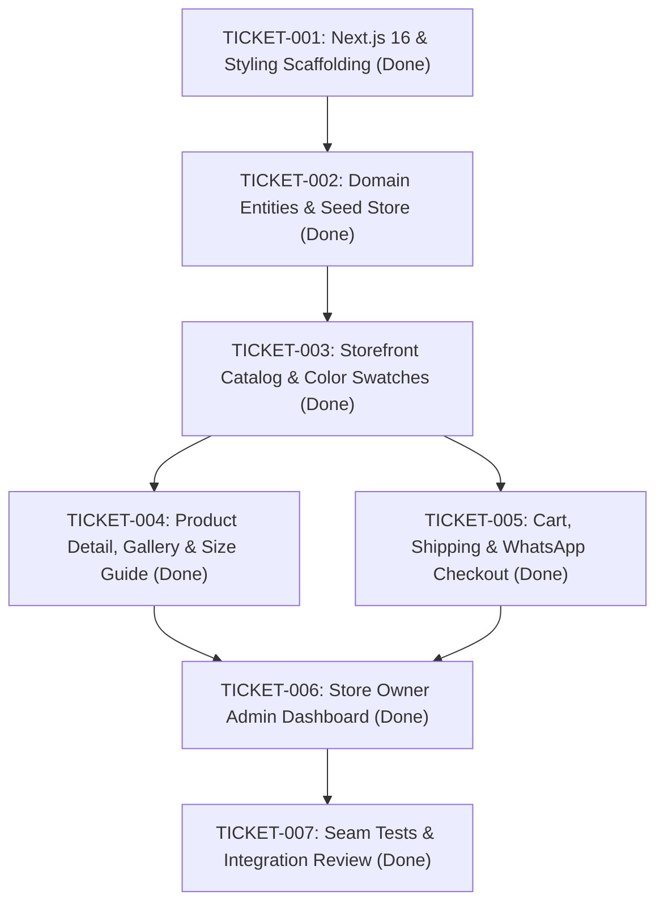

# Implementation Task Graph (Tickets)

## Ticket Definitions

### TICKET-001: Next.js 16 & Styling Scaffolding
- **Status**: Completed
- **Result**: Next.js 16.4.3 App Router initialized with TypeScript, Tailwind CSS v4, Arabic Cairo font, and RTL layout support.

### TICKET-002: Domain Entities & Seed Store
- **Status**: Completed
- **Result**: Core domain types in `src/types/index.ts` and storage engine `src/lib/store.ts` supporting color variant albums, availability states, shipping calculation, and luxury apparel seeds.

### TICKET-003: Storefront Catalog & Interactive Color Swatches
- **Status**: Completed
- **Result**: Product card with live hover/click color swatches that swap garment photos immediately, category filtering, search, and sorting.

### TICKET-004: Product Detail, Color-Linked Gallery & Size Guide
- **Status**: Completed
- **Result**: `/product/[slug]` with gallery syncing to chosen color, dimmed/faded UI for inactive colors, size selection with out-of-stock strikethroughs, modal size guide with cm measurements, and automatic smooth redirect to catalog on add-to-cart.

### TICKET-005: Cart, Shipping Calculation & WhatsApp Guest Checkout
- **Status**: Completed
- **Result**: Slide-over cart drawer with free shipping progress bar, guest checkout supporting Egyptian governorates with automatic shipping rates, and receipt screen with 1-click WhatsApp order confirmation.

### TICKET-006: Store Owner Admin Dashboard
- **Status**: Completed
- **Result**: `/admin` dashboard with Arabic UI, product CRUD, color album photo manager, 1-click active/faded toggle switches, and order status workflow with direct WhatsApp messaging.

### TICKET-007: Seam Tests & Integration Review
- **Status**: Completed
- **Result**: 10 automated unit tests passing across all critical public seams; production build verified and clean.
